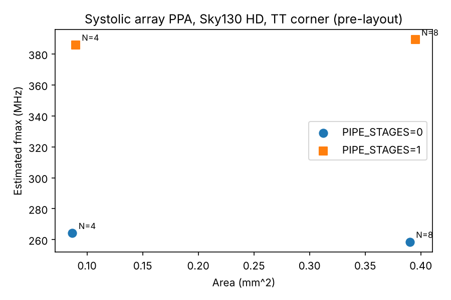

# systolic-accel-sky130

A parameterizable INT8 weight-stationary systolic-array matrix-multiply accelerator in Verilog, verified with cocotb against a NumPy golden model and synthesized to the SkyWater 130nm HD standard-cell library with Yosys + ABC. Includes a Python PPA sweep across array size and pipeline depth.

## Architecture

```
            w_flat (N*N*8, loaded once per matrix via w_load)
               |
 a_row[0] --> PE(0,0) --> PE(0,1) --> ... --> PE(0,N-1)
               |            |                    |
 a_row[1] --> PE(1,0) --> PE(1,1) --> ... --> PE(1,N-1)      a flows right (1 reg/PE)
               |            |                    |           psum flows down (1 reg/PE)
              ...          ...                  ...
               |            |                    |
 a_row[N-1]-> PE(N-1,0)-> PE(N-1,1)-> ... --> PE(N-1,N-1)
               |            |                    |
            c_col[0]     c_col[1]   ...      c_col[N-1]
```

Each PE stores one INT8 weight, multiplies the incoming activation by it, adds the partial sum from above, and passes the activation right and the 32-bit partial sum down. For an input row `a` (length N) the array produces `a @ W`.

**Timing contract.** Lane `i` of `a_row` must be skewed by `i` cycles (the testbench does this). Column `j` of the result for input row `k` appears on `c_col[j]` after edge `k + (N-1) + j + PIPE_STAGES`.

**Parameters**

| Parameter | Values | Effect |
|---|---|---|
| `N` | any (swept 4, 8) | N x N PEs, N^2 MACs per cycle |
| `PIPE_STAGES` | 0, 1 | 1 registers the 8x8 product before the 32-bit add, splitting the MAC path |

## Verification

- cocotb 2.x on Icarus Verilog, NumPy golden model (`A @ W`, int64)
- 25 random weight matrices x 400 random rows = **10,000 vectors per configuration**, full signed INT8 range including -128
- All four configurations (N in {4, 8} x PIPE_STAGES in {0, 1}) pass with **0 mismatches**
- Lint: `iverilog -Wall` and `yosys check -assert` clean

## Synthesis and PPA

Yosys 0.33 + ABC, `sky130_fd_sc_hd` typical corner (`tt_025C_1v80`). ABC maps with delay-oriented `map -p`, buffering, and gate sizing, then reports the critical path with `stime -p`.

| N | PIPE | Area (mm^2) | Cells | Flops | Critical path (ns) | Est. fmax (MHz) | Est. peak GOPS |
|---|------|-------------|-------|-------|--------------------|-----------------|----------------|
| 4 | 0 | 0.0868 | 10102 | 640 | 3.285 | 264.2 | 8.45 |
| 4 | 1 | 0.0897 | 11254 | 884 | 2.091 | 385.9 | 12.35 |
| 8 | 0 | 0.3901 | 46846 | 2816 | 3.369 | 258.5 | 33.09 |
| 8 | 1 | 0.395 | 48430 | 3816 | 2.069 | 389.2 | 49.82 |



**How to read these numbers.** They are pre-layout: no placement, wires, or clock tree. Critical path is ABC's combinational logic delay with no wire load. Est. fmax adds a fixed 0.5 ns for flop clock-to-Q plus setup: `fmax = 1 / (crit_path + 0.5 ns)`. Peak GOPS counts 2 ops per MAC per cycle. Post-route numbers from OpenLane would be lower. That flow is the next step (see Roadmap).

## Design questions

**1. Where is the critical path, and why does pipelining move it?**
Without pipelining, one cycle has to fit the full MAC: the 8x8 signed multiplier's partial-product tree, then the 32-bit carry chain of the accumulate. Registering the 16-bit product splits that into two shorter stages, multiply and add. The longest remaining stage sets the clock. The path dropped from 3.29 ns to 2.09 ns (-36%) at N=4 and from 3.37 ns to 2.07 ns (-39%) at N=8.

**2. What did pipelining cost?**
Each PE gets up to 16 more flops; Yosys trims bits it can prove constant (244 more at N=4, 1,000 more at N=8). Total area grew only 3.3% at N=4 and 1.3% at N=8. With slack on both stages, ABC no longer has to upsize gates on the long MAC path, which offsets most of the new flop area. Latency grows by one cycle for the whole array, not one per PE: the activation skew between rows stays at 1 cycle because the partial sum still advances one row per cycle.

**3. Why does the critical path barely change from N=4 to N=8?**
In a systolic array every PE only talks to its neighbours through registers. There are no long broadcast wires and no reduction trees spanning the array, so the per-cycle logic is the same MAC regardless of N. Throughput scales with N^2 while the cycle time stays flat, which is the core reason systolic arrays suit ML accelerators. Post-layout, the global `w_load`/`w_flat` and reset nets would grow with N and would need buffering.

**4. Why weight-stationary?**
Inference reuses one weight matrix across many activation rows. Keeping weights in PE registers means each weight is loaded once per matrix while activations stream through, which minimizes weight traffic. Output-stationary would keep accumulators in place instead. It suits cases where partial sums are expensive to move, at the cost of streaming both operands.

## Run it

```
pip install cocotb numpy matplotlib
sudo apt install iverilog yosys

make sim        # 10k-vector regression, all 4 configs
make lint
make ppa        # synthesis sweep -> results/ppa.{csv,md,png}
```

The Sky130 HD liberty file is fetched by `make lib` from OpenROAD-flow-scripts. It is ~12 MB and not committed.

## Roadmap

- OpenLane 2 floorplan, placement, CTS, and routing for post-layout timing, area, and power
- Clock gating on idle PEs, and a power comparison with activity from simulation (VCD/SAIF)
- Output-stationary variant for comparison
- AXI-Stream wrapper with input skew and output deskew FIFOs in RTL
